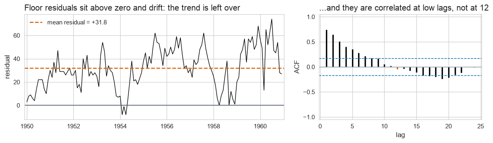

# Forecasting International Air Passengers

Submitted by: Layan Mohammed Alharbi — academy: @SDAIAAcademy

Capstone project for the **[@SDAIAAcademy](https://github.com/SDAIAAcademy)
Time Series course** — the full forecasting pipeline, start to finish, on the
Box & Jenkins **AirPassengers** series: exploration, decomposition, a benchmark
floor, a model zoo through a framework (AutoGluon), rolling-origin
cross-validation, and a report for a manager.

> **Headline result:** a seasonal ARIMA model (**AutoARIMA**) cuts the forecast
> error roughly **in half** against the "copy last year" benchmark
> (MASE **0.65** vs **1.31**) across **eight test years**, and is also the best
> on the whole forecast distribution. Its 80% band is honest-ish but **too
> narrow** (70% coverage), and the analysis shows why.

| | |
|---|---|
| **Author** | Layan Mohammed Alharbi |
| **Academy** | [@SDAIAAcademy](https://github.com/SDAIAAcademy) — Time Series course capstone |
| **Notebook** | [`project.ipynb`](project.ipynb) — runs top to bottom in under a minute |
| **Report** | [`report.md`](report.md) — 2–3 pages, written for a manager |

---

## 1. The problem

**Data:** monthly international airline passengers, January 1949 – December
1960 — 144 months, no gaps (thousands of passengers).

**Goal:** forecast the next 12–24 months, and prove the forecast is better than
the simplest sensible alternative — with honest uncertainty bands, not just a
single number.

**Rule of the project:** *the process, not the number.* Every result has to
come from a rolling-origin test (many forecast origins, not one lucky holdout),
every model is compared against a benchmark floor, intervals are scored, and
nothing is allowed to "see" data from the future (no leakage).

---

## 2. What I did — the pipeline

```
Explore  →  Set the floor  →  Check what the floor misses  →  AutoGluon zoo
         →  Rolling-origin harness (8 years)  →  Pick a model  →  Read its residuals
         →  Report  (+ extra credit: dynamic regression on temperature)
```

| step | method | tools |
|---|---|---|
| Exploration | time plot, STL decomposition, trend & seasonal strength, ACF | `statsmodels` |
| The floor | Seasonal Naive (+ Naive, Naive with drift as extra benchmarks) | `statsforecast` |
| Floor diagnostics | residuals `y_t − y_{t−12}`, their ACF, 80% coverage | `coursekit` |
| Framework | hand-written conversion to `TimeSeriesDataFrame`, a zoo of 5 local models + ensemble, leaderboard | `autogluon.timeseries` |
| Harness | 8 rolling origins, h = 12, step = 12 (forecasts 1953 → 1960) — MASE, RMSSE, scaled CRPS, 80% coverage | `statsforecast`, `coursekit.scoring` |
| Extra credit | ARIMA with a temperature regressor, leakage-free per fold | Open-Meteo archive, `statsforecast` |

---

## 3. Exploration — what the series looks like


- **Trend:** steady growth from ~127k passengers/month (1949) to ~476k (1960).
- **Seasonality:** every year peaks in July–August and dips in November.
- **The key detail:** the summer swing grows with the traffic (44k → 232k
  between best and worst month), so the seasonality is **multiplicative** —
  a share of the level, not a fixed amount.


**STL decomposition** — the **trend** does most of the work; the **seasonal**
component keeps the same shape but its amplitude grows almost fivefold; the
**remainder** is small but larger in later years (the multiplicative effect
leaking through).

| measure | value | what it implies |
|---|---|---|
| Trend strength | **1.00** | a model **must** carry a trend |
| Seasonal strength | **0.99** | a model **must** carry a season |


**ACF** — slow decay at every lag (the trend) with bumps at **lag 12 and 24**
(the yearly season). In plain words: *"the number keeps going up, and every
month looks a lot like the same month a year earlier."*

---

## 4. The floor — and what it leaves on the table

The **seasonal naive** forecast (*next January = last January*) is the
benchmark every model has to beat.



| what's left in the floor's residuals | finding | which model eats it |
|---|---|---|
| Trend | residuals average **+32k**, not zero | a model with differencing / a trend state |
| Low-lag autocorrelation | ACF ≈ **0.75, 0.65, 0.50** at lags 1–3 | an AR term |
| Seasonality (lag 12) | ACF ≈ **−0.04** — fully used | nothing more needed |

**Floor's band:** claims 80%, covers only **51%** of the tested months →
**not honest** (the error is the missing trend, which is systematic, not random).

---

## 5. The framework — AutoGluon

The data was converted to AutoGluon's format **by hand** (`unique_id → item_id`,
`ds → timestamp`, `y` as target) and a zoo of five local models was fitted
(Naive, SeasonalNaive, AutoETS, AutoARIMA, Theta) plus a WeightedEnsemble.

| model | score_test (1960) | score_val (1959) |
|---|---|---|
| AutoARIMA | **−0.61** | −1.58 |
| Theta | −0.88 | −1.63 |
| WeightedEnsemble | −0.93 | **−1.54** |
| AutoETS | −1.17 | −1.55 |
| SeasonalNaive | −1.57 | −1.66 |
| Naive | −2.50 | −3.20 |

**My reading:**
- The scores are **negative** because AutoGluon reports error metrics with the
  sign flipped (higher = better): `−0.61` means MASE 0.61.
- Each score is from **one 12-month window** — and the ranking **flips**
  between 1959 (ensemble/ETS first) and 1960 (ARIMA first).
- So the leaderboard is good for **shortlisting** (every trend + season model
  beats both naives) but **cannot be trusted to rank** — which is why the
  shortlist goes to the harness.

---

## 6. The harness — the real test (8 years)

Every model forecasts 12 months ahead from **8 different origins** (end of
1952, 1953, … 1959), on exactly the same folds as the floor.

| model | MASE ↓ | RMSSE ↓ | scaled CRPS ↓ | 80% coverage | 80% band width |
|---|---|---|---|---|---|
| **AutoARIMA** ⭐ | **0.647** | **0.683** | **0.034** | **69.8%** | 44k |
| AutoTheta | 0.898 | 0.988 | 0.046 | 59.4% | 58k |
| AutoETS | 0.952 | 1.003 | 0.050 | 49.0% | 49k |
| Seasonal Naive *(floor)* | 1.313 | 1.246 | 0.062 | 51.0% | 78k |
| Naive with drift | 1.813 | 2.156 | 0.095 | 76.0% | 149k |
| Naive | 2.119 | 2.452 | 0.110 | 68.8% | 143k |


**Analysis:**
- **AutoARIMA wins both halves:** −51% error on the point forecast (MASE) and
  −45% on the whole distribution (CRPS) against the floor.
- It beats the floor in **7 of 8 years**. It loses only in **1958** — the year
  growth stalled, so copying 1957 was nearly perfect.
- **AutoETS** shows a split worth reporting: it beats the floor on accuracy but
  its band covers *less* than the floor's (49% vs 51%).
- **Coverage verdict:** only the drift benchmark lands in the honest range
  (76%), and only by being 3× wider while forecasting worse. Every useful model
  is too narrow; AutoARIMA is closest (70%). The misses come a **whole year at
  a time** (1955: 50%, 1959: 0%) — years when growth jumped above trend.

---

## 7. The best model — AutoARIMA

Selected model: **ARIMA(1,1,0)(0,1,0)[12]** — one regular difference (removes
the trend), one seasonal difference (removes the season), and one AR term (the
month-to-month momentum the floor left behind).


- **1961 forecast:** **6.04 million** passengers (vs 5.71 million in 1960).
- **80% band width:** 30k at month 1 → 82k at month 12 → 181k at month 24.


**What it still misses:** the residuals are centred and pattern-free (the one
crossing at lag 23 is the expected ~1-in-24 false alarm), but they are
**~1.5× larger in 1957–60 than in 1950–53**. The model works on raw counts, so
it assumes an error costs the same number of passengers in every year — which
is why its band is too narrow in the busy years.

---

## 8. Extra credit — does weather drive traffic?

**Driver:** monthly mean temperature at New York (JFK) from the
[Open-Meteo](https://open-meteo.com/) historical archive, cached in
[`data/temperature_nyc_monthly.csv`](data/temperature_nyc_monthly.csv).

**No leakage:** future temperature is unknown at forecast time, so each fold
uses the monthly **climatology computed only from its own training years**.

| model | MASE | CRPS | 80% coverage |
|---|---|---|---|
| AutoARIMA (harness) | 0.647 | 0.034 | 69.8% |
| AutoARIMA + temperature | 0.665 | 0.034 | 70.8% |

**Result:** temperature does **not** help — it mostly repeats the seasonal
pattern that seasonal differencing already removes. A good driver must carry
information the calendar doesn't (fares, income, route capacity).

---

## 9. Conclusions

1. **Ship AutoARIMA** — it halves the error of the benchmark over eight test
   years and is best on the full distribution.
2. **Treat its 80% band as roughly a 70% band** until the next step is done.
3. **Next step:** model the **logarithm** of passengers, so errors scale with
   traffic — expected to keep the forecast similar while making the band
   narrower in quiet years and wider in busy ones, moving coverage toward 80%.
4. **One holdout is not a ranking** — AutoGluon's single-window leaderboard
   flipped between two neighbouring years; only the 8-year harness settled it.

---

## How to run

**Colab:** open [`project.ipynb`](project.ipynb) in Google Colab and run all
cells — the first cell clones this repo and installs everything (AutoGluon is
installed automatically when section 3 is reached).

**Locally (Python 3.11–3.13):**

```bash
python -m venv .venv && source .venv/bin/activate
pip install -e . "autogluon.timeseries" jupyter
jupyter nbconvert --to notebook --execute project.ipynb
```

## Repository contents

| file | what it is |
|---|---|
| [`project.ipynb`](project.ipynb) | the full analysis — the graded deliverable |
| [`report.md`](report.md) | the 2–3 page report for a manager |
| [`figures/`](figures) | charts saved by the notebook and used in the report |
| [`data/temperature_nyc_monthly.csv`](data/temperature_nyc_monthly.csv) | cached driver for the extra credit |
| `coursekit/` | the course's plotting and scoring harness |
| `brief.md`, `rubric.md` | the project brief and grading rubric from @SDAIAAcademy |

---

*Built by **Layan Mohammed Alharbi** as the capstone for the
[@SDAIAAcademy](https://github.com/SDAIAAcademy) Time Series course.*
