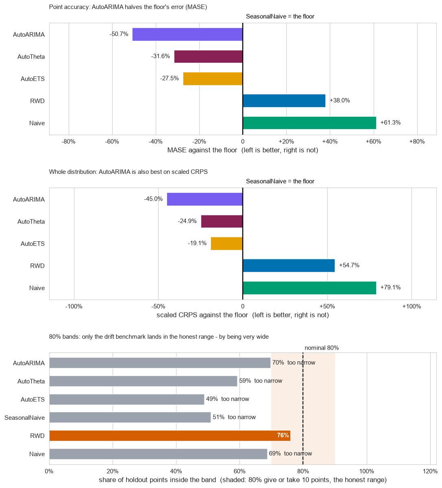
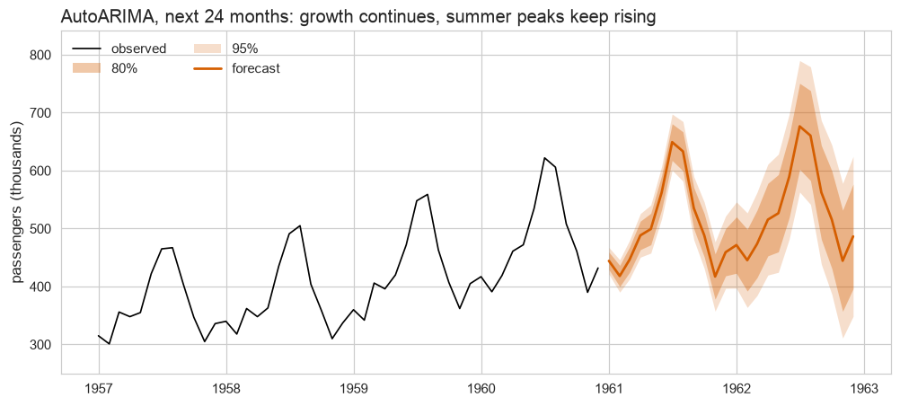
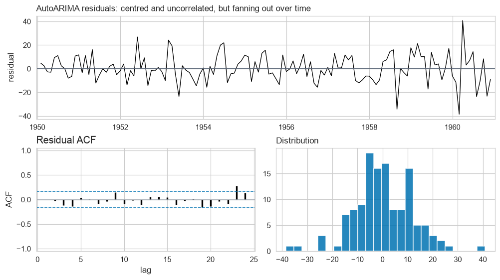

# Forecasting international air passengers — report

*Prepared by Layan Mohammed Alharbi · Time Series capstone, [@SDAIAAcademy](https://github.com/SDAIAAcademy).
Every number below comes from `project.ipynb`.*

## At a glance

| | |
|---|---|
| **Recommendation** | Use the seasonal ARIMA model (AutoARIMA) for the monthly passenger forecast |
| **The number that earns it** | Error score **0.65** against **1.31** for the "copy last year" benchmark — about **half the error** |
| **How it was tested** | Eight separate test years (1953–1960), each forecast using only the data available at the time |
| **Forecast for 1961** | **6.04 million** passengers, against 5.71 million in 1960 |
| **How much to trust the range** | The "80%" band contained the actual figure **70%** of the time — treat it as a 70% band for now |
| **Next step** | Model the *percentage* changes (logarithm) instead of raw counts, to make the band honest |

## The data and the question

The data is the classic Box & Jenkins airline series: **monthly international airline passengers from
January 1949 to December 1960** — 144 months, in thousands of passengers, no gaps
([source](https://stat.ethz.ch/R-manual/R-devel/library/datasets/html/AirPassengers.html)).
The question: how many passengers should we plan for over the next one to two years, and how far
off could that number be?

**The series in two sentences.** Passengers grew steadily for twelve years, from about 127 thousand a month
in 1949 to about 476 thousand in 1960, and every year has the same shape: a peak in July–August and a low in
November. The summer peak grows with the airline — the gap between the best and worst month went from
44 thousand to 232 thousand — so the seasonal swing is a share of the traffic, not a fixed number of passengers.

## How the models were judged

Every model was tested the way it would be used: standing at the end of a year, forecasting the next twelve
months, then checking against what actually happened. That was repeated for **eight different years (1953 to
1960)**, so no model can win by being lucky in one year, and no model was ever allowed to see the months it was
forecasting. Each model was scored three ways:

- **Average error, relative to the simplest forecast (MASE).** 1.0 means "as bad as copying last year's same
  month"; 0.5 means half that error. Lower is better.
- **Quality of the whole range of outcomes (scaled CRPS).** Rewards a forecast whose range is both tight and
  right. Lower is better.
- **Coverage of the 80% band.** If a model says "80% of the time the truth will fall in this range", it should
  actually happen about 80% of the time.

The benchmark every model had to beat — **the floor** — is the simplest seasonal forecast:
*next January = last January*. Two even simpler forecasts (repeat last month; extend the average growth) were
included for reference.

## Recommendation

**Ship the seasonal ARIMA model (AutoARIMA): across eight test years it cut the forecast error roughly in half
compared with the "copy last year" benchmark (error score 0.65 vs 1.31).**

AutoARIMA is a standard statistical forecasting model that learns three things from the history: the growth,
the yearly pattern, and the month-to-month momentum (a good month tends to be followed by another good month).

| model | avg error (MASE) | range quality (CRPS) | 80% band coverage | avg 80% band width |
|---|:---:|:---:|:---:|:---:|
| **AutoARIMA (recommended)** | **0.65** | **0.034** | **70%** | **44k** |
| AutoTheta | 0.90 | 0.046 | 59% | 58k |
| AutoETS | 0.95 | 0.050 | 49% | 49k |
| Seasonal naive (the floor) | 1.31 | 0.062 | 51% | 78k |
| Naive with drift | 1.81 | 0.095 | 76% | 149k |
| Naive (no season) | 2.12 | 0.110 | 69% | 143k |

The evidence behind the recommendation:

- It is best on **both** accuracy measures, not just one: **51% lower error** and **45% better range quality**
  than the floor.
- It beat the floor in **7 of the 8 test years**. The one loss, 1958, was the year growth stalled and copying
  1957 happened to be nearly perfect.
- Not every model that beats the floor is better overall: AutoETS had a lower error than the floor, but its
  band was *less* reliable (49% coverage vs 51%).
- The automated tool (AutoGluon) ranked the candidates on a single year and changed its mind between 1959 and
  1960. The eight-year test settles the order.
- For 1961 it forecasts **6.04 million passengers**, against 5.71 million in 1960 — continued growth with the
  same summer peak.

## The intervals: how wide, and are they honest?

- **Width.** In the eight-year test the 80% band averaged **44 thousand passengers** wide (about ±22 thousand
  around the forecast) — roughly half the floor's width. On the 1961–62 forecast the band widens the further
  ahead it looks:

  | months ahead | 1 | 12 | 24 |
  |---|:---:|:---:|:---:|
  | 80% band width | 30k | 82k | 181k |

- **Coverage.** It promised 80% and delivered **70%** of the 96 tested months. That is the best of the useful
  models (the floor managed 51%), but it is **10 points short**.
- **Verdict: not yet honest — slightly too narrow.** The misses come a whole year at a time: in 1955 and 1959,
  when growth jumped above trend, actual traffic sat above the band for months on end (1959: 0% covered). For
  planning, treat the 80% band as roughly a 70% band, or widen it until the fix below is in place. The only
  model whose band lands near 80% (naive with drift, 76%) gets there by being more than three times wider while
  forecasting worse — not a trade worth making.

## The residuals: what the model missed

The residuals are what is left after the model's one-month-ahead forecast — the part of each month it did not
predict. They were checked by eye on the residual chart and its autocorrelation chart (whether one month's
miss predicts the next).

- **What the floor missed, the model caught.** The floor's leftovers averaged +32 thousand (it never catches up
  with growth) and were strongly linked month to month (a good month predicts another good month). The chosen
  model removed both: its leftovers average almost exactly zero and show no pattern at short gaps or at 12 months.
- **What the model still misses: its errors grow with the traffic.** The leftovers are about **1.5 times larger
  in 1957–60 than in 1950–53**. The model is fitted on raw passenger counts, so it assumes a mistake costs the
  same number of passengers in 1950 as in 1960. That is why its band is too narrow in the busy years.
- One small blip in the pattern check (a 23-month echo) has no business meaning and is the kind of false alarm
  expected about once in 24 checks.

## One change

**Model the logarithm of passengers instead of the raw count, then put it through the same eight-year test.**
On a log scale a 5% error is a 5% error in any year, which matches what the residuals show. Expected effect:
the forecast itself should change little (the shape is already captured), but the 80% band should become
**narrower in quiet early years and wider in busy later years**, moving coverage from 70% towards the promised
80%. If it does not, the next step is to calibrate the band directly on past forecast errors.

## Extra: does weather drive traffic?

Monthly mean temperature at New York (JFK), from the free Open-Meteo weather archive, was added as a driver,
using only temperatures that would have been known at the time of each forecast. It did **not** help (error
0.665 vs 0.647, coverage 71% vs 70%): temperature mostly repeats the seasonal pattern the model already has.
A driver earns its place only if it says something the calendar does not — fares, income or route capacity
are better candidates.
